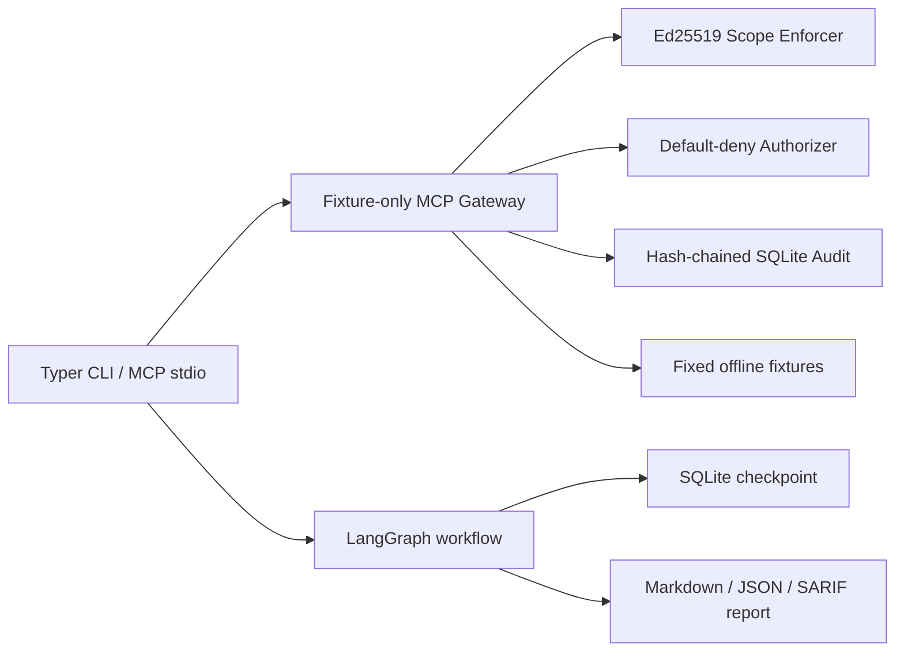

# SENTINEL

> **SENTINEL is for authorized security testing only. You are solely responsible for obtaining written authorization for every target.**

**Scope-enforced, MCP-native security orchestration for authorized engagements.** This release is an **offline simulation prototype**: it does not scan hosts, connect to targets, launch security tools, exploit systems, or make LLM-driven decisions. Every registered tool returns a clearly labeled synthetic fixture. No target is contacted or tested, and outputs are not observations about live systems. The fixed fixture backend cannot be changed through YAML to run commands or access the network.

## What it does

- Verifies Ed25519-signed, time-bounded scope manifests before an engagement.
- Enforces scope and default-deny role policy at the gateway before each fixture request.
- Records allow/deny decisions in a tamper-evident, SHA-256 hash-chained SQLite log.
- Uses LangGraph with SQLite checkpointing for a resumable simulation workflow and a human approval pause.
- Exposes the same fixture-only gateway as an optional stdio MCP server.
- Generates Markdown, JSON, and SARIF reports from synthetic fixtures; reports contain no real findings.

## Not included

No Nmap/sqlmap/Nuclei/Metasploit/Hydra/ffuf integration; no custom command runner; no network-capable sandbox; no real vulnerability validation; no autonomous LLM. The Docker image is only a packaging example for the local simulator, not a security-tool image. Do not treat fixture output as evidence about a real system. Any future live-testing extension requires a separate security review and must preserve the execution-boundary checks.

## Quickstart

Python 3.12+ and `uv` are required.

```bash
uv sync --locked --extra dev
uv run sentinel init
uv run sentinel tools list
uv run sentinel engage --scope scope.yaml --approve-simulation
uv run sentinel audit verify --db sentinel-audit.sqlite3
```

`sentinel init` creates an Ed25519 keypair and a signed scope limited to the documentation-only `192.0.2.0/24` range. To choose a different target, use `sentinel init --target example.org` only when you have written authorization; this command still only runs synthetic fixtures and does not contact it. The private key is written with owner-only permissions and ignored by Git. Keep it private.

For a manual approval pause, omit `--approve-simulation`; the CLI asks before resuming the fixture-only stage. The approval is not permission to perform real testing.

## Scope manifest

The manifest is signed as canonical JSON (excluding `signature`) with Ed25519. `scope.yaml` is bound to a public key ID and valid-from/valid-until interval. Exclusions override authorizations. Domains include their subdomains; CIDR authorization only covers addresses within the declared network. Scope and policy are rechecked at the gateway before each call.

```yaml
engagement_id: ENG-LOCAL-001
authorized_targets:
  - type: cidr
    value: 192.0.2.0/24
excluded_targets: []
allowed_tool_categories: [recon, scanning, reporting]
prohibited_actions: [dos, credential_attack, destructive_exploit, exploitation, shell_execution, live_scanning]
valid_from: '2026-01-01T00:00:00Z'
valid_until: '2027-01-01T00:00:00Z'
signing_key_id: ed25519:<generated-key-id>
signature: <generated-signature>
mode: mock_only
```

## CLI

```text
sentinel init [--target TARGET] [--scope PATH]
sentinel engage --scope PATH [--public-key PATH] [--audit-db PATH] [--approve-simulation]
sentinel resume ENGAGEMENT_ID
sentinel report ENGAGEMENT_ID --format md|json|sarif
sentinel audit list [--engagement-id ID] [--db PATH]
sentinel audit verify [--db PATH]
sentinel tools list
sentinel tools info TOOL_NAME
sentinel mcp status
sentinel mcp serve
```

The MCP server uses stdio and exposes only `list_mock_tools` and `simulate`. Its gateway accepts only the fixed `simulate_*` registry entries, validates the signed scope, and returns only static synthetic fixtures. It does not proxy to other MCP servers.

## Architecture



See [Architecture](docs/ARCHITECTURE.md), [Safety](docs/SAFETY.md), [Tool Registry](docs/TOOL_REGISTRY.md), and [Deployment](docs/DEPLOYMENT.md).

## Development

```bash
uv run ruff check --no-respect-gitignore .
uv run mypy src/sentinel
uv run pytest --cov=sentinel
bash scripts/audit-dependencies.sh
uv build
```

Docker is optional and was unavailable in this build environment, so the Compose setup has not been run here. The in-process fixture backend is not a security-tool sandbox; the container configuration only packages the simulator and disables runtime networking.
