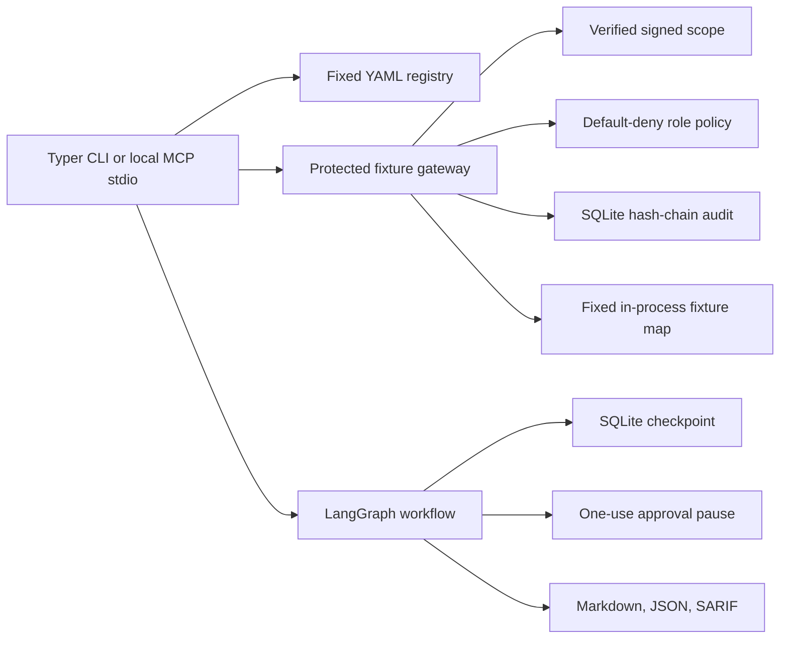

# Architecture

## Runtime boundary

SENTINEL has no LLM client, live tool adapter, command runner, or network client. The target string is accepted only as a scope label and is returned with a static fixture. The MCP server is local stdio only; it does not listen on a TCP port or proxy to other MCP servers.

## Request path

1. `sentinel init` creates an Ed25519 key pair, a seven-day `mock_only` scope, and a signature. It refuses to overwrite any existing scope or key.
2. `runtime.create_gateway` reads the public key and verifies the manifest signature, signing-key ID, time window, schema, and required prohibitions.
3. The LangGraph `validate_scope` node checks that workflow state matches the verified manifest and that the selected target is allowed for each workflow category.
4. Each `MCPGateway.call` checks the session principal, exact registered tool, empty arguments, role policy, scope validity, authorized target, exclusions, and category. Denials are audited and raise before fixture dispatch.
5. The gateway records an allow event before calling the fixed in-process fixture provider, then records completion or failure. No process, shell, socket, HTTP request, or scanner library is used.
6. LangGraph pauses before the optional synthetic verification fixture. A short-lived one-use token is bound to the engagement and reviewer. Declining does not block the report; it skips that fixture.
7. Reports are generated from the fixture list and always have an empty findings list; results are not observations about the target.

## Persistence

- Scope signature: `scope.yaml`; private Ed25519 key is owner-only and excluded by `.gitignore`.
- Audit events and approval tokens: local SQLite database. Each event hashes canonical JSON and the previous event hash.
- Workflow checkpoint: separate SQLite file used by LangGraph's SQLite checkpointer.
- Reports: `reports/` by default, in Markdown, JSON, and SARIF 2.1.0.

The audit chain detects ordinary row edits and reordered/deleted rows; it is not an externally anchored, immutable ledger. An administrator able to rewrite the database can also recompute the chain. Back up audit data separately if it matters.
